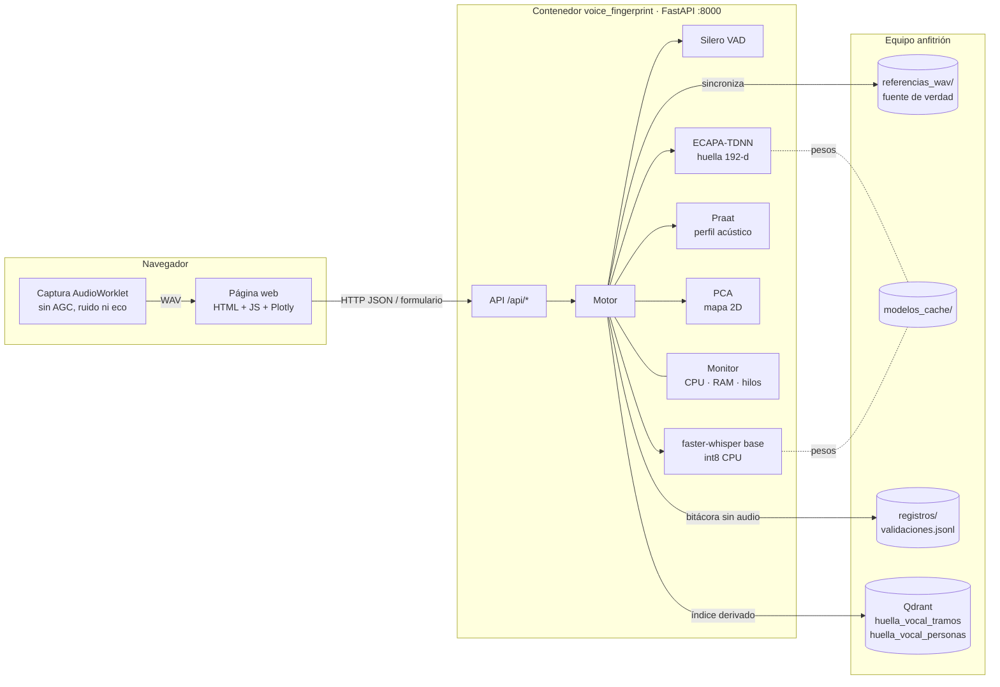
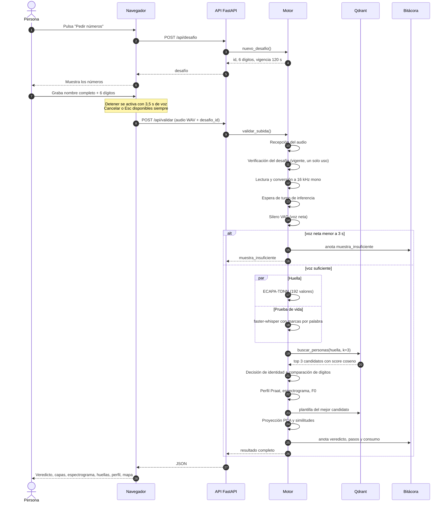
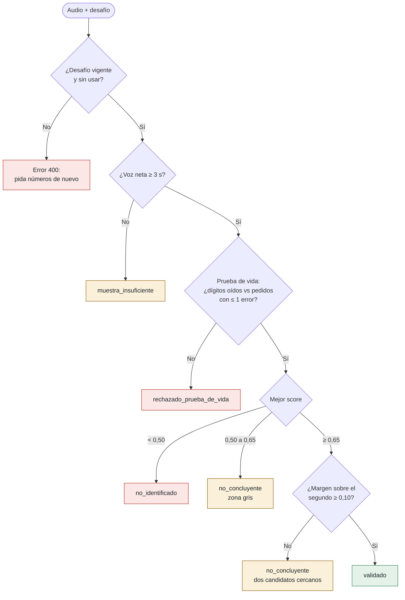
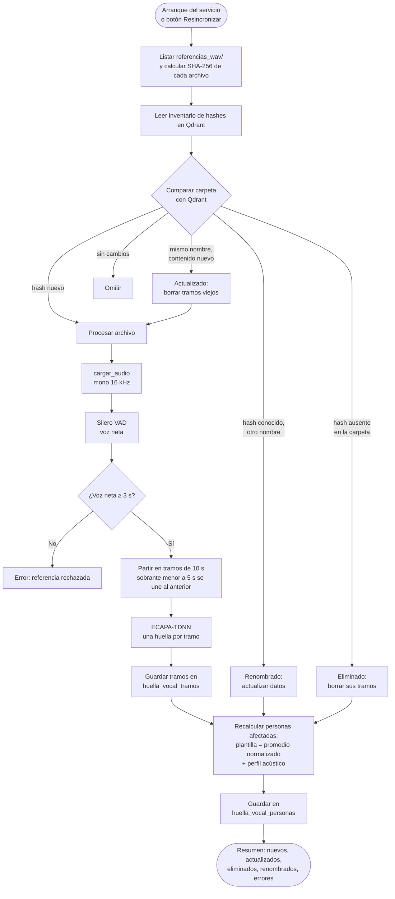
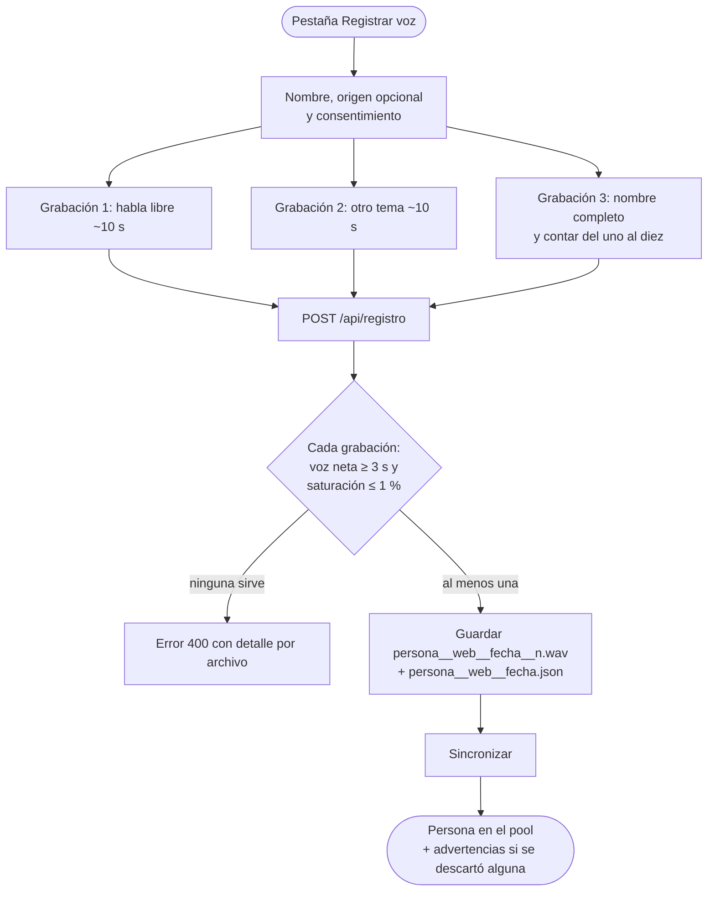
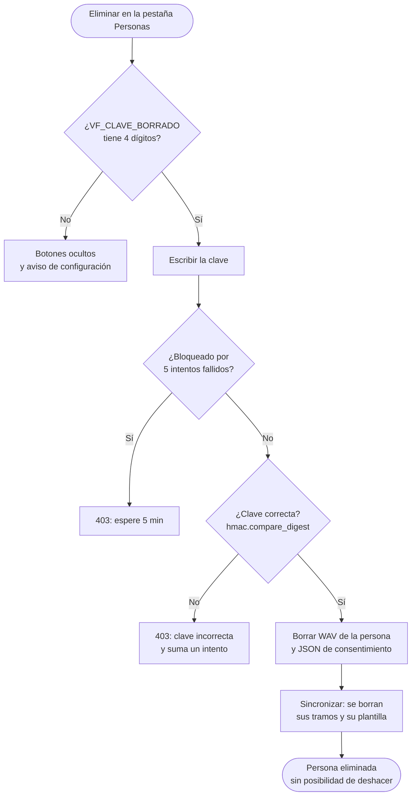
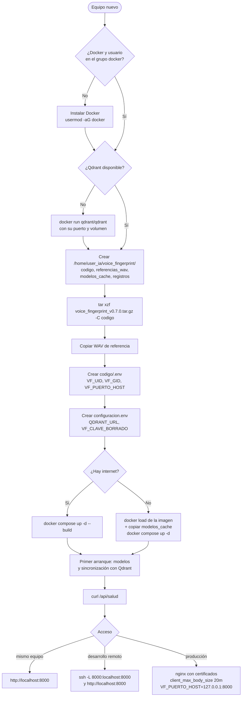

# voice_fingerprint — Documentación del proyecto (versión 0.7.0)

Prueba de concepto completa, del backend al frontend, de **validación de identidad por voz**: la voz se trata como una huella digital. Una persona dice su nombre y unos números que aparecen en pantalla; el sistema comprueba que los dijo en vivo (prueba de vida) y busca a quién del registro corresponde su voz (identificación 1:N).

Este documento sirve para retomar el proyecto en otro chat o para desplegarlo en otro equipo. Describe el estado del checkpoint `voice_fingerprint_v0.7.0.tar.gz`.

---

## Contenido

1. [Resumen](#1-resumen)
2. [Decisiones de diseño](#2-decisiones-de-diseño)
3. [Arquitectura](#3-arquitectura)
4. [Flujo de una validación](#4-flujo-de-una-validación)
5. [Componentes en detalle](#5-componentes-en-detalle)
6. [La página web](#6-la-página-web)
7. [API](#7-api)
8. [Estructura de carpetas y archivos](#8-estructura-de-carpetas-y-archivos)
9. [Configuración y parámetros](#9-configuración-y-parámetros)
10. [Tecnologías y versiones](#10-tecnologías-y-versiones)
11. [Despliegue desde cero](#11-despliegue-desde-cero-en-homeuser_ia)
12. [Operación diaria](#12-operación-diaria)
13. [Solución de problemas](#13-solución-de-problemas)
14. [Limitaciones conocidas](#14-limitaciones-conocidas)
15. [Pendientes y hoja de ruta](#15-pendientes-y-hoja-de-ruta)
16. [Historial de versiones y decisiones](#16-historial-de-versiones-y-decisiones)
17. [Diagramas (Mermaid)](#17-diagramas-mermaid)
18. [Glosario](#18-glosario)

---

## 1. Resumen

| Aspecto | Decisión actual |
|---|---|
| Tipo de identificación | 1:N de conjunto abierto: se busca entre todas las personas registradas y se admite que la voz no sea de nadie |
| Huella vocal | ECAPA-TDNN (SpeechBrain, entrenado en VoxCeleb): vector de 192 valores |
| Base vectorial | Qdrant, distancia coseno, dos colecciones (tramos y personas) |
| Prueba de vida | Desafío de 6 dígitos al azar, de un solo uso, con 2 minutos de vigencia; se transcribe con faster-whisper `base` int8 y se admite 1 error |
| Perfil acústico | Praat (parselmouth): F0, HNR, jitter, shimmer, formantes y longitud estimada del tracto vocal. **Explica** el resultado, **no decide** |
| Fuente de verdad | La carpeta `referencias_wav/`. Qdrant es un índice derivado que se reconstruye desde ella |
| Backend | FastAPI + uvicorn (1 proceso), en CPU |
| Frontend | HTML/CSS/JS sin framework, Plotly para los gráficos, diseño neutro y sobrio |
| Despliegue | Docker Compose; funciona igual en arm64 (DGX Spark) y x86_64 |
| Captura de la demo | Micrófono del PC desde el navegador. La telefonía a 8 kHz queda para después |
| Idioma | Español (interfaz, mensajes y código) |

**Entornos:**
- **Casa (x86_64):** desarrollo inicial, usuario `nfb`.
- **DGX Spark de desarrollo:** arm64, con internet, usuario `admin`, proyecto en `/home/user_ia/voice_fingerprint`. Ya tiene Qdrant en Docker con los puertos por defecto (6333/6334). Funciona por HTTP y se accede desde otro equipo con un túnel SSH.
- **DGX Spark empresarial (futuro):** Qdrant se instalará después, quizás en otros puertos, y el servicio quedará detrás de un proxy reverso nginx con certificados reales.

---

## 2. Decisiones de diseño

- **Prueba de vida solo contra repetición (replay), no contra clonación.** Se descartó detectar voces sintéticas o clonadas en esta demo. Los dígitos al azar impiden reutilizar una grabación vieja; burlarlos exigiría un sistema de clonación que genere en vivo, con la voz de la víctima, los dígitos exactos en menos de 2 minutos.
- **Dígitos en vez de frases.** La primera versión pedía leer frases largas y se descartó por impráctica. Ahora la persona dice su nombre completo y luego 6 dígitos (590.490 combinaciones posibles, sin dos dígitos iguales seguidos).
- **Zona gris en la decisión.** Entre los umbrales bajo y alto, o cuando dos personas quedan muy cerca, la respuesta es "no concluyente, repita", en lugar de forzar un sí o un no.
- **La carpeta manda.** Los WAV de `referencias_wav/` son la verdad; Qdrant se sincroniza al arrancar y con el botón "Resincronizar". Si se borra Qdrant, se reconstruye sin perder nada.
- **Huella de persona = plantilla.** Cada archivo se parte en tramos de 10 s de voz neta; cada tramo da una huella; la plantilla de la persona es el promedio normalizado de todas sus huellas de tramo.
- **El perfil acústico es explicativo.** Ayuda a entender por qué dos voces se parecen (tono, timbre, tracto vocal), pero la decisión depende solo de la similitud entre huellas.
- **HTTP sin certificados autofirmados.** El navegador solo permite el micrófono en HTTPS o en `localhost`; en desarrollo se usa un túnel SSH y en producción nginx pondrá el HTTPS.
- **Borrado definitivo protegido.** Eliminar a una persona desde la página borra sus WAV, su JSON de consentimiento y su huella, y exige una clave de 4 dígitos.

---

## 3. Arquitectura

```
 Navegador (página)                         Contenedor voice_fingerprint (FastAPI, puerto 8000)
 ───────────────────                        ──────────────────────────────────────────────────
 Captura con AudioWorklet  ── WAV ──▶  /api/validar ──▶ Motor
 (sin AGC, sin supresión                                 ├─ Silero VAD ............ voz neta
  de ruido ni cancelación                                ├─ ECAPA-TDNN ............ huella 192-d ─┐
  de eco)                                                ├─ faster-whisper (paralelo) dígitos   │
                                                         ├─ Praat ................. perfil      │
 Plotly: espectrograma,     ◀── JSON ──                  └─ PCA ................... mapa 2D     │
 huellas, mapa, tiempos                                                                         │
                                                                                                ▼
 referencias_wav/ (fuente de verdad) ──sincronización──▶  Qdrant  (huella_vocal_tramos, huella_vocal_personas)
 modelos_cache/  (modelos descargados)
 registros/      (bitácora de validaciones, sin audio)
```

- **Un solo proceso** (`workers=1`): los modelos se cargan una vez al arrancar.
- **Hilos:** la transcripción y la huella corren en paralelo. Un candado de inferencia evita que una sincronización y una validación usen los modelos al mismo tiempo.
- **Monitor de recursos:** un hilo en segundo plano muestrea CPU, RAM e hilos cada segundo.

---

## 4. Flujo de una validación

1. **Pedir números.** La página llama a `POST /api/desafio`. El servidor genera 6 dígitos, los guarda con un identificador y una vigencia de 2 minutos, y los devuelve.
2. **Grabar.** La persona dice su nombre completo y luego los 6 números. El botón "Detener y validar" se activa solo cuando el medidor del navegador cuenta 3,5 s de voz; el máximo es 12 s. Siempre hay un botón **Cancelar** (y la tecla Esc).
3. **Enviar.** `POST /api/validar` con el audio WAV y el identificador del desafío.
4. **En el servidor** (cada paso queda medido para la pestaña "Tiempos y recursos"):

| Paso | Qué hace |
|---|---|
| Recepción del audio | Guarda el audio recibido en un archivo temporal |
| Verificación del desafío | Comprueba que el desafío exista, no haya vencido y no se haya usado; lo marca como gastado y recupera los dígitos pedidos. No escucha el audio |
| Lectura y conversión a 16 kHz | Decodifica el audio, lo pasa a mono y lo remuestrea a 16 kHz |
| Espera de turno de inferencia | Espera el candado de los modelos (solo se nota si hay una sincronización en curso) |
| Detección de voz (Silero VAD) | Quita los silencios; si queda menos de 3 s de voz neta, responde "muestra insuficiente" |
| Huella vocal (ECAPA-TDNN) | Extrae la huella de 192 valores |
| Transcripción (Whisper) | En paralelo con la huella: transcribe con marcas de tiempo por palabra |
| Búsqueda 1:N en Qdrant | Los 3 candidatos más parecidos entre las plantillas de personas |
| Decisión y prueba de vida | Compara los dígitos oídos con los pedidos (1 error permitido) y aplica los umbrales de identidad |
| Perfil acústico (Praat) | F0, HNR, jitter, shimmer, formantes, tracto vocal |
| Espectrograma mel | Datos del espectrograma para dibujarlo en la página |
| Trayectoria del tono (F0) | La línea de tono sobre el espectrograma |
| Huella del mejor candidato | Recupera de Qdrant la plantilla del primer candidato para compararla visualmente |
| Proyección en el mapa 2D | Ubica la muestra en el mapa PCA y calcula su similitud con cada persona |
| Registro en la bitácora | Escribe una línea en `registros/validaciones.jsonl` (sin audio) |

5. **Veredicto:**

| Veredicto | Condición |
|---|---|
| `validado` | Prueba de vida aprobada **y** identidad identificada |
| `rechazado_prueba_de_vida` | Los dígitos oídos no coinciden con los pedidos (más de 1 error) |
| `no_concluyente` | Zona gris, o dos candidatos demasiado cercanos |
| `no_identificado` | Ningún candidato llega al umbral bajo |
| `muestra_insuficiente` | Menos de 3 s de voz neta |

**Regla de identidad** (sobre la similitud coseno con las plantillas):
- **Identificado:** mejor score ≥ 0,65 **y** margen sobre el segundo ≥ 0,10.
- **No concluyente:** mejor score ≥ 0,65 pero margen < 0,10, o mejor score entre 0,50 y 0,65.
- **No identificado:** mejor score < 0,50.

Calibración observada: la misma persona con el mismo canal da entre 0,73 y 0,82; con distinto canal (grabación con `arecord` frente a navegador) bajó a 0,67. Esa sensibilidad al canal es la razón del pendiente AS-norm.

---

## 5. Componentes en detalle

### 5.1 Pool de referencias y sincronización

La carpeta `referencias_wav/` admite tres convenciones de nombre:

| Formato | Ejemplo | Interpretación |
|---|---|---|
| Archivos existentes | `andres_col.wav`, `andres_col_2.wav`, `maria.wav` | Nombre; sufijo de país opcional (`col`, `arg`, `mex`, `ven`, `chi`, `pe`, `pr`, etc.); un número final (si hay nombre y país) es otra grabación de la misma persona |
| Corpus OpenSLR | `cof_01523.wav` | `co` = Colombia, `f` = mujer, `01523` = hablante; se muestra como "Mujer 01523", origen Colombia. Prefijos: co, ar, cl, pe, pr, ve |
| Registro web | `ana-maria-rojas__web__20261109-162732__1.wav` + `ana-maria-rojas__web__20261109-162732.json` | El JSON guarda el nombre para mostrar, el origen y el consentimiento |

Todos los archivos con el mismo identificador de persona se suman a la misma persona.

**Sincronización** (al arrancar, en segundo plano, y con el botón "Resincronizar"):
- Identifica cada archivo por el hash SHA-256 de su contenido; el ID del punto en Qdrant es un uuid5 de ese hash.
- Detecta archivos nuevos, eliminados, modificados y renombrados (mismo contenido, otro nombre) y solo procesa lo que cambió.
- Por archivo: carga → VAD → voz neta → tramos de 10 s (un sobrante de menos de 5 s se une al tramo anterior; una voz de entre 3 y 5 s queda como un solo tramo; menos de 3 s se rechaza) → una huella por tramo.
- Recalcula la plantilla y el perfil de cada persona afectada.
- El resumen muestra nuevos, actualizados, eliminados, renombrados, duplicados, errores, sin cambios, personas recalculadas y duración.

**Qdrant:** dos colecciones con el prefijo configurable (por defecto `huella_vocal`):
- `huella_vocal_tramos`: un punto por tramo, con persona, archivo, hash y segundos.
- `huella_vocal_personas`: un punto por persona, con su plantilla, nombre, origen, número de tramos, voz total y perfil acústico.

### 5.2 Prueba de vida

- `desafio.py` genera 6 dígitos con `secrets.SystemRandom`, sin dos iguales seguidos.
- Whisper transcribe; `prueba_vida.py` normaliza el texto y extrae los dígitos, tanto escritos como cifras ("4") como en palabras ("cuatro", "cuarenta y siete" → 4, 7).
- Se compara con distancia de Levenshtein contra cualquier tramo contiguo de lo oído, así que lo que la persona diga antes (su nombre) no estorba. Se aprueba con 1 error como máximo.
- Con las marcas de tiempo por palabra se ubica cada dígito en el espectrograma.

### 5.3 Huella e identificación

- `huella.py`: ECAPA-TDNN produce una huella de 192 valores normalizada a norma 1. La similitud es el coseno (producto punto entre vectores normalizados).
- `almacen.py`: búsqueda de los 3 candidatos más cercanos en la colección de personas.
- `decision.py`: aplica la regla de la sección 4.

### 5.4 Perfil acústico

`perfil.py` con Praat calcula, sobre la voz neta (mínimo 1 s):
- F0 mediana y percentiles 5 y 95 (piso 75 Hz, techo 500 Hz).
- HNR (dB), jitter (%), shimmer (%).
- Formantes F1 a F4 (Hz).
- Longitud estimada del tracto vocal (cm) a partir del espaciamiento entre formantes: VTL = c / (2·ΔF), con c = 35.000 cm/s.

En habla continua, el jitter y el shimmer salen más altos que las normas clínicas (que usan vocales sostenidas); solo deben compararse entre muestras.

Rangos de referencia que muestra la página (aproximados, adultos hablando):
- F0: hombres 85–155 Hz, mujeres 165–255 Hz.
- Tracto vocal: mujeres 13,5–15,5 cm, hombres 16–18,5 cm.

### 5.5 Registro web

- Tres grabaciones: dos de habla libre (unos 10 s cada una, sobre un tema sugerido) y una de "nombre completo y contar del uno al diez". Mínimo 4 s de voz por grabación en el medidor del navegador; máximo 15 s.
- Exige nombre y consentimiento.
- El servidor revisa cada grabación (al menos 3 s de voz neta, saturación ≤ 1 %), guarda los WAV y el JSON en `referencias_wav/` y sincroniza.
- Si la persona no queda en el pool, responde con error y el detalle por archivo. Si alguna grabación se descartó, lo informa como advertencia.
- Registrar dos veces el mismo nombre suma las grabaciones a la misma persona.

### 5.6 Eliminación de personas

- Solo está activa si `VF_CLAVE_BORRADO` tiene exactamente 4 dígitos; si no, los botones no aparecen y la pestaña explica cómo activarlos.
- La clave se compara con `hmac.compare_digest`. Tras 5 intentos fallidos, el borrado queda bloqueado 5 minutos.
- Borra todos los WAV de la persona, sus JSON de consentimiento y su huella, y luego resincroniza. No se puede deshacer.

### 5.7 Tiempos y recursos

- `servicio/recursos.py`:
  - `Cronometro`: inicio y duración de cada paso, y en qué carril corrió (principal o paralelo).
  - `Monitor`: muestras cada segundo de los últimos 5 minutos, más el consumo de cada validación (segundos de CPU del proceso y pico de RAM, muestreado cada 50 ms).
  - `ficha_sistema` y `estadisticas`: mediana y p95 por paso.
- Los pasos y el consumo se guardan en la bitácora, así que el historial sobrevive a los reinicios.
- El CPU se expresa como porcentaje de la máquina completa (100 % = todos los núcleos ocupados). Dentro de Docker, "máquina" es la vista del anfitrión.
- El CPU no se puede separar por paso, porque PyTorch y CTranslate2 usan hilos internos propios.

---

## 6. La página web

Cuatro pestañas:

**Validar identidad**
- Botón "Pedir números", los 6 dígitos en grande y la vigencia en cuenta regresiva.
- "Grabar respuesta" con medidor de nivel y de segundos de voz, y botón Cancelar.
- Resultado:
  - Veredicto.
  - Dos capas: prueba de vida (dígitos pedidos frente a oídos) e identidad (candidatos con score y margen).
  - Espectrograma mel de la voz de entrada: eje de frecuencia logarítmico de 50 Hz a 8 kHz, línea de F0 y cada dígito marcado en verde o rojo.
  - Huellas como código de barras (muestra frente a candidato), más una franja de aporte de cada posición a la similitud, con detalle al pasar el mouse.
  - Tabla del perfil acústico con explicación de cada medida al pasar el mouse, y escalas de referencia de tono y tracto con los rangos de hombres y mujeres.
  - Mapa 2D (PCA) interactivo: la muestra como estrella unida a sus 3 voces más parecidas, colores por tono mediano, opción de mostrar todos los nombres.

**Registrar voz**
- Nombre, origen opcional, consentimiento y tres grabaciones guiadas, cada una con Cancelar y opción de repetir.

**Personas registradas**
- Estado de la sincronización y botón "Resincronizar".
- Mapa de las voces.
- Tabla del pool, con botón "Eliminar" y confirmación con clave si el borrado está habilitado.

**Tiempos y recursos**
- Línea de tiempo de la última validación.
- Consumo de esa validación.
- Historial (mediana y p95 de las últimas 200).
- Recursos en vivo: CPU y RAM, actualizados cada 2 s solo mientras la pestaña está abierta.
- Ficha del sistema y modelos con su tiempo de carga.

**Detalles técnicos del frontend**
- Captura con AudioWorklet (`procesador-grabacion.js`) y codificación WAV en el navegador, a la frecuencia del navegador (normalmente 48 kHz). Se desactivan AGC, supresión de ruido y cancelación de eco para no deformar la voz.
- El medidor de voz del navegador usa un umbral de energía de max(0,008, ruido × 2,5), con 200 ms de retención.
- Plotly `plotly-cartesian` 4.1.2 vendorizado (funciona sin internet), con la configuración regional en español.
- Fuente Public Sans incluida (licencia OFL).
- Los contenedores de los gráficos tienen alto fijo para que el zoom no los encoja.

---

## 7. API

Todas las rutas van bajo `/api`. La página se sirve en `/`.

| Método y ruta | Uso |
|---|---|
| `GET /salud` | Estado general, personas en el pool, estado de la sincronización, si el borrado está habilitado |
| `GET /sincronizacion` | Avance y último resumen de la sincronización |
| `POST /sincronizacion` | Lanza una resincronización (409 si ya hay una en curso) |
| `GET /personas` | El pool: nombre, origen, tramos, segundos de voz, perfil acústico |
| `POST /personas/{id}/eliminar` | Cuerpo JSON `{"clave": "1234"}`. Borra definitivamente (403 si la clave es incorrecta o el borrado está bloqueado) |
| `GET /mapa` | Proyección 2D de tramos y personas |
| `POST /desafio` | Nuevos dígitos de un solo uso: identificador, dígitos, textos, vigencia |
| `POST /validar` | Formulario con `audio` (archivo) y `desafio_id`. Devuelve veredicto, prueba de vida, identificación, muestra (huella, perfil, espectrograma, posición en el mapa, similitudes), mejor candidato y tiempos |
| `POST /registro` | Formulario con `nombre`, `origen`, `consentimiento` y varios archivos de audio |
| `GET /tiempos` | Última validación paso a paso e historial (mediana y p95) |
| `GET /recursos` | Muestras de CPU, RAM e hilos (últimos 5 min) |
| `GET /sistema` | Arquitectura, procesador, memoria, versiones, GPU, modelos y tiempos de carga |

Los errores de uso responden 400 con `{"detalle": "..."}`.

---

## 8. Estructura de carpetas y archivos

En cada equipo:

```
/home/user_ia/voice_fingerprint/
├── codigo/                     ← contenido de voice_fingerprint_v0.7.0.tar.gz
│   ├── Dockerfile
│   ├── docker-compose.yml
│   ├── .dockerignore
│   ├── requirements.txt
│   ├── configuracion.env.ejemplo
│   ├── configuracion.env       ← se crea en cada equipo (no viene en el paquete)
│   ├── .env                    ← se crea en cada equipo (no viene en el paquete)
│   ├── huella_vocal/           ← núcleo: audio, modelos, sincronización, decisión
│   ├── servicio/               ← API, motor y medición de recursos
│   └── frontend/               ← página web
├── referencias_wav/            ← fuente de verdad del pool (WAV + JSON de registros web)
├── modelos_cache/              ← modelos descargados (se llena en el primer arranque)
└── registros/                  ← validaciones.jsonl (bitácora sin audio)
```

**`huella_vocal/` (núcleo, sin dependencia de la web)**

| Archivo | Contenido |
|---|---|
| `config.py` | Constantes (frecuencia, umbrales, tramos, desafío, países), conexión a Qdrant por variables de ambiente, caché de modelos |
| `audio.py` | `cargar_audio`: mono, 16 kHz, float32; informa pico, dBFS, saturación. Respaldo con PyAV para webm y m4a |
| `vad.py` | `DetectorVoz` (Silero) y `partir_en_tramos` |
| `huella.py` | `ExtractorHuella` (ECAPA-TDNN), `normalizar`, `plantilla`, `similitud` |
| `perfil.py` | `perfil_acustico` y `trayectoria_tono` (Praat) |
| `referencias.py` | Convenciones de nombre, listado de la carpeta, hash de archivos |
| `desafio.py` | Generación de los dígitos |
| `prueba_vida.py` | Normalización del texto, extracción de dígitos, Levenshtein, `Transcriptor` (faster-whisper) con marcas de tiempo |
| `almacen.py` | `Almacen`: colecciones de Qdrant, tramos, personas, búsqueda |
| `sincronizacion.py` | Sincronización carpeta → Qdrant |
| `decision.py` | Regla de decisión con zona gris |
| `visual.py` | Datos del espectrograma mel y PCA para el mapa |

**`servicio/`**

| Archivo | Contenido |
|---|---|
| `__main__.py` | Arranque con uvicorn (`python -m servicio`); HTTPS opcional con `VF_SSL_CERT` y `VF_SSL_KEY` |
| `app.py` | Rutas FastAPI, manejo de errores, montaje del frontend |
| `motor.py` | `Motor`: carga de modelos, sincronización, desafíos, validación medida, registro, eliminación, mapa, tiempos y ficha |
| `recursos.py` | Cronómetro de pasos, monitor de CPU y RAM, ficha del sistema, estadísticas |

**`frontend/`**

| Archivo | Contenido |
|---|---|
| `index.html` | Estructura de las cuatro pestañas |
| `estilos.css` | Estilos (variables de color, paneles, tablas, ayudas emergentes, escalas) |
| `app.js` | Lógica de la página: pestañas, desafío, grabación controlada con Cancelar, resultado, registro, personas, tiempos y recursos |
| `grabadora.js` | Clase `Grabadora` (captura, cancelación, WAV) y medidor de voz |
| `procesador-grabacion.js` | AudioWorklet de captura |
| `graficos.js` | Espectrograma, mapa, huellas, línea de tiempo y gráficos de recursos con Plotly |
| `vendor/plotly-cartesian.min.js` | Plotly 4.1.2 (licencia MIT) |
| `fuentes/` | Public Sans (licencia OFL) |

**Scripts de desarrollo** (no vienen en el paquete; estaban en el equipo de casa): `fase0/` verificación del entorno y elección de modelos, `fase1/analizar_pool.py` análisis del pool y curvas EER, `fase2/calibrar_prueba_vida.py` calibración de los dígitos, `fase3/sincronizar.py` e `identificar.py` pruebas por consola, `fase4/probar_api.py` prueba de la API.

---

## 9. Configuración y parámetros

### 9.1 Variables de ambiente

**`codigo/.env`** (lo usa Docker Compose):

| Variable | Uso | Ejemplo |
|---|---|---|
| `VF_UID`, `VF_GID` | Usuario con el que corre el contenedor; debe ser el dueño de las carpetas | `id -u`, `id -g` |
| `VF_PUERTO_HOST` | Puerto publicado en el equipo. Con `127.0.0.1:8000` solo es accesible desde el propio equipo (útil detrás de nginx) | `8000` |

**`codigo/configuracion.env`** (la carga el contenedor):

| Variable | Uso | Por defecto |
|---|---|---|
| `QDRANT_URL` | URL de Qdrant. Desde Docker, Qdrant del mismo equipo es `http://host.docker.internal:<puerto>`. `:memory:` usa una base temporal | `http://localhost:6333` |
| `QDRANT_API_KEY` | Llave de Qdrant si tiene autenticación | vacía |
| `QDRANT_PREFIJO` | Prefijo de las colecciones | `huella_vocal` |
| `VF_CLAVE_BORRADO` | Clave de 4 dígitos para eliminar personas; vacía = borrado deshabilitado | vacía |
| `VF_HOST`, `VF_PUERTO` | Solo sin Docker | `0.0.0.0`, `8000` |
| `VF_SSL_CERT`, `VF_SSL_KEY` | Solo sin Docker y sin nginx: certificado y llave para servir HTTPS directo | — |

Las fija `docker-compose.yml`: `VF_REFERENCIAS`, `VF_MODELOS`, `VF_REGISTROS` (rutas dentro del contenedor, `/datos/...`). Sin Docker, por defecto son las carpetas hermanas de `codigo/`.

### 9.2 Parámetros del núcleo (`huella_vocal/config.py`)

| Constante | Valor | Significado |
|---|---|---|
| `SR` | 16000 | Frecuencia de trabajo (Hz) |
| `DIM_HUELLA` | 192 | Tamaño de la huella |
| `MODELO_STT` | `base` | Modelo de faster-whisper |
| `UMBRAL_ALTO` | 0,65 | Score mínimo para identificar |
| `UMBRAL_BAJO` | 0,50 | Por debajo: no identificado |
| `MARGEN_MINIMO` | 0,10 | Ventaja mínima sobre el segundo candidato |
| `SEGUNDOS_MIN_VALIDACION` | 3,0 | Voz neta mínima para validar |
| `DIGITOS_DESAFIO` | 6 | Dígitos del desafío |
| `ERRORES_DIGITOS_PERMITIDOS` | 1 | Errores tolerados en los dígitos |
| `SEGUNDOS_TRAMO` | 10,0 | Largo de cada tramo de referencia |
| `SEGUNDOS_MIN_TRAMO` | 5,0 | Sobrante mínimo para ser tramo propio |
| `SEGUNDOS_MIN_REFERENCIA` | 3,0 | Voz neta mínima de un archivo de referencia |

Otros parámetros:
- `servicio/motor.py`: vigencia del desafío 120 s; 5 intentos de clave antes de bloquear; 5 minutos de bloqueo.
- `frontend/app.js`: mínimo de voz para validar 3,5 s y máximo 12 s; mínimo para registrar 4 s y máximo 15 s.

---

## 10. Tecnologías y versiones

**Imagen Docker:**
- Base `python:3.12-slim-bookworm`, construcción en dos etapas.
- La primera etapa tiene `build-essential` y `cmake`, porque en arm64 `praat-parselmouth` no tiene rueda y se compila desde el código fuente (unos 8–10 minutos).
- Entorno virtual en `/opt/huellavoz_env`.
- PyTorch desde el índice de CPU (evita descargar las librerías CUDA).

| Paquete | Versión |
|---|---|
| torch / torchaudio | 2.15.0 / 2.11.1 (índice CPU) |
| speechbrain | 1.1.2 |
| faster-whisper | 1.2.1 |
| silero-vad | 6.2.3 |
| praat-parselmouth | 0.4.7 |
| soundfile | 0.14.0 |
| numpy / scipy | 2.5.4 / 1.18.1 |
| matplotlib | 3.11.2 |
| qdrant-client | 1.19.1 |
| fastapi / uvicorn | 0.162.2 / 0.54.0 |
| python-multipart | 0.0.33 |
| httpx | 0.28.1 |
| psutil | 7.2.2 |

**Modelos** (se descargan en `modelos_cache/` en el primer arranque):
- `speechbrain/spkrec-ecapa-voxceleb` en `modelos_cache/speechbrain/`.
- faster-whisper `base` en `modelos_cache/faster_whisper/`.
- Silero VAD viene dentro del paquete `silero-vad`.

Todo corre en CPU, también en la DGX Spark: la GPU no se usa.

---

## 11. Despliegue desde cero en `/home/user_ia/`

### 11.1 Requisitos del equipo

- Linux arm64 o x86_64 con Docker Engine y el plugin Docker Compose v2 (`docker compose version`).
- El usuario que despliega (por ejemplo `admin`) debe pertenecer al grupo `docker` y no trabajar como root.
- Internet para construir la imagen (Debian, PyPI, índice de PyTorch) y para el primer arranque (Hugging Face). Para un equipo sin internet, vea la sección 11.9.
- Qdrant accesible (puede estar en el mismo equipo o en otro).
- Unos 6 GB libres en disco (imagen, modelos y margen).

Si Docker responde "permission denied":

```bash
sudo usermod -aG docker "$USER"
newgrp docker
docker ps
```

### 11.2 Qdrant (solo si el equipo no lo tiene)

```bash
mkdir -p /home/user_ia/qdrant_storage

docker run -d \
  --name qdrant \
  --restart unless-stopped \
  -p 6333:6333 \
  -p 6334:6334 \
  -v /home/user_ia/qdrant_storage:/qdrant/storage \
  qdrant/qdrant:v1.19.1

curl -s http://localhost:6333/ | head -c 200
```

La versión de Qdrant es la que se usó en desarrollo; cualquier 1.x reciente compatible con `qdrant-client` 1.19 sirve. Si por restricciones los puertos deben ser otros, cambie la parte izquierda de `-p` (por ejemplo `-p 16333:6333`) y use ese puerto en `QDRANT_URL`.

### 11.3 Carpetas del proyecto

```bash
sudo mkdir -p /home/user_ia/voice_fingerprint
sudo chown -R "$USER":"$USER" /home/user_ia/voice_fingerprint

cd /home/user_ia/voice_fingerprint
mkdir -p \
  codigo \
  referencias_wav \
  modelos_cache \
  registros
```

Las cuatro carpetas deben existir antes de arrancar: `docker-compose.yml` no las crea (`create_host_path: false`) para evitar que Docker las cree como root.

### 11.4 Código

Copie `voice_fingerprint_v0.7.0.tar.gz` a `/home/user_ia/voice_fingerprint/` y extráigalo dentro de `codigo/`:

```bash
cd /home/user_ia/voice_fingerprint
tar xzf voice_fingerprint_v0.7.0.tar.gz -C codigo
ls codigo
# Dockerfile  configuracion.env.ejemplo  docker-compose.yml  frontend  huella_vocal  requirements.txt  servicio
```

### 11.5 Referencias (pool inicial)

Copie los WAV de referencia a `referencias_wav/`, con las convenciones de la sección 5.1. Recomendaciones:
- Una persona por archivo y más de 30 s de voz por persona.
- Si viene de otro equipo con registros web, copie también los `.json` que acompañan a los WAV `__web__`.

```bash
cp /ruta/origen/*.wav /home/user_ia/voice_fingerprint/referencias_wav/
```

También puede arrancar con la carpeta vacía y registrar voces desde la página.

### 11.6 Configuración

```bash
cd /home/user_ia/voice_fingerprint/codigo

cat > .env <<EOF
VF_UID=$(id -u)
VF_GID=$(id -g)
VF_PUERTO_HOST=8000
EOF

cp configuracion.env.ejemplo configuracion.env
chmod 600 configuracion.env
nano configuracion.env
```

En `configuracion.env` ajuste:
- `QDRANT_URL`:
  - Qdrant en el mismo equipo: `http://host.docker.internal:6333` (o el puerto que use).
  - Qdrant en otro servidor: `http://<host>:<puerto>`.
- `QDRANT_API_KEY`, si Qdrant la exige.
- `VF_CLAVE_BORRADO`: 4 dígitos para poder eliminar personas desde la página.

### 11.7 Construir y arrancar

```bash
cd /home/user_ia/voice_fingerprint/codigo
docker compose up -d --build
docker compose logs -f
```

- La primera construcción tarda: en arm64, unos 10–15 minutos por la compilación de parselmouth.
- En el primer arranque se descargan los modelos a `modelos_cache/` y se sincroniza el pool con Qdrant; el registro lo muestra.
- Salga del registro con Ctrl+C (el servicio sigue corriendo).

Verifique:

```bash
curl -s http://localhost:8000/api/salud
docker compose ps        # debe decir "healthy" después de unos minutos
```

### 11.8 Acceso desde el navegador

El navegador solo permite el micrófono en HTTPS o en `localhost`.

- **En el mismo equipo:** abra `http://localhost:8000`.
- **Desde otro equipo (desarrollo):** abra un túnel SSH y luego `http://localhost:8000` en ese equipo:

  ```bash
  ssh -L 8000:localhost:8000 admin@<IP_DEL_SERVIDOR>
  ```

- **Producción (nginx con certificados):** vea la sección 11.12, con dos configuraciones completas. Dos puntos clave:
  - `client_max_body_size` de al menos `20m`. Las grabaciones viajan como WAV a la frecuencia del navegador (normalmente 48 kHz): una validación de 12 s pesa más de 1 MB y un registro de tres grabaciones, más de 4 MB, y el límite por defecto de nginx es 1 MB.
  - Si el nginx corre en el mismo equipo que el servicio, ponga `VF_PUERTO_HOST=127.0.0.1:8000` en `codigo/.env` para que el contenedor no sea accesible desde la red.

### 11.9 Equipo sin internet (Spark empresarial)

Construya la imagen en un equipo con internet **de la misma arquitectura** (la Spark de desarrollo, arm64) y llévela junto con los modelos:

```bash
# En el equipo con internet
docker save voice_fingerprint:0.7.0 | gzip > voice_fingerprint_imagen_0.7.0.tar.gz
tar czf modelos_cache.tar.gz -C /home/user_ia/voice_fingerprint modelos_cache

# En el equipo destino (después de los pasos 11.3 a 11.6)
docker load < voice_fingerprint_imagen_0.7.0.tar.gz
tar xzf modelos_cache.tar.gz -C /home/user_ia/voice_fingerprint
cd /home/user_ia/voice_fingerprint/codigo
docker compose up -d            # sin --build: usa la imagen cargada
```

### 11.10 Actualizar a una versión nueva

```bash
cd /home/user_ia/voice_fingerprint
tar xzf voice_fingerprint_vX.Y.Z.tar.gz -C codigo
cd codigo
docker compose up -d --build
```

- `configuracion.env` y `.env` no se tocan.
- Si la versión nueva trae variables nuevas, compárelas con `configuracion.env.ejemplo`.
- Recargue la página con Ctrl+Shift+R.

### 11.11 Sin Docker (opcional, para desarrollo)

```bash
cd /home/user_ia/voice_fingerprint/codigo
uv venv --python 3.12 huellavoz_env
source huellavoz_env/bin/activate
uv pip install torch==2.15.0 torchaudio==2.11.1 --index-url https://download.pytorch.org/whl/cpu
uv pip install -r requirements.txt

cp configuracion.env.ejemplo configuracion.env      # QDRANT_URL=http://localhost:6333
set -a; source configuracion.env; set +a
python -m servicio
```

Sin `uv`, se puede usar `python3.12 -m venv` con `pip install --break-system-packages` si hiciera falta.

### 11.12 Proxy reverso con nginx en la red interna

Escenario: el servicio corre en el servidor **xxx.xx.x.xxx** (puerto 8000). Ese equipo tiene su propio nginx, pero los certificados están en el nginx de otro equipo, **yyy.yy.y.yyy**, que es el que atiende a los usuarios por HTTPS. Reemplace las IP, nombres, puertos y rutas de ejemplo por los reales.

**Condición del servicio:** la página llama a la API con rutas absolutas (`/api/...`). Por eso necesita un **nombre propio** (por ejemplo `huellavocal.empresa.local`) o un **puerto propio** en yyy. No funciona en una subruta como `https://servidor/huella/` sin cambiar el código.

#### Opción A: yyy → xxx:8000 directo (la más simple)

```
Usuarios ──HTTPS──▶ nginx yyy (certificados) ──HTTP red interna──▶ xxx:8000 (contenedor)
```

**En xxx** no cambia nada: `VF_PUERTO_HOST=8000` en `codigo/.env`.

**En yyy**, cree `/etc/nginx/conf.d/huella_vocal.conf`:

```nginx
upstream huella_vocal {
    server xxx.xx.x.xxx:8000;
    keepalive 8;
}

server {
    listen 80;
    server_name huellavocal.empresa.local;
    return 301 https://$host$request_uri;
}

server {
    listen 443 ssl;
    server_name huellavocal.empresa.local;

    ssl_certificate     /ruta/al/certificado.crt;
    ssl_certificate_key /ruta/a/la/llave.key;

    client_max_body_size 20m;      # los WAV de validación y registro superan el 1 MB por defecto
    proxy_read_timeout   120s;     # registrar y eliminar esperan una sincronización
    proxy_send_timeout   120s;

    location / {
        proxy_pass         http://huella_vocal;
        proxy_http_version 1.1;
        proxy_set_header   Connection "";
        proxy_set_header   Host $host;
        proxy_set_header   X-Real-IP $remote_addr;
        proxy_set_header   X-Forwarded-For $proxy_add_x_forwarded_for;
        proxy_set_header   X-Forwarded-Proto $scheme;
    }
}
```

```bash
sudo nginx -t
sudo systemctl reload nginx
```

**Limitación:** el puerto 8000 de xxx queda abierto a toda la red, por HTTP y sin control de acceso. Además, **ufw no lo bloquea**, porque Docker publica los puertos con sus propias reglas de iptables y se salta ufw. Para cerrarlo hay que filtrar en la cadena `DOCKER-USER`:

```bash
sudo iptables -I DOCKER-USER -p tcp -m conntrack --ctorigdstport 8000 ! -s yyy.yy.y.yyy -j DROP
```

Esa regla se pierde al reiniciar el equipo si no se guarda (con `iptables-persistent` o el mecanismo del equipo). Por eso se recomienda la opción B.

#### Opción B: el nginx de xxx como portero (recomendada)

```
Usuarios ──HTTPS──▶ nginx yyy ──HTTP──▶ nginx xxx :8080 (solo acepta a yyy) ──▶ 127.0.0.1:8000 (contenedor)
```

El contenedor deja de ser accesible desde la red y el control de acceso queda en nginx, que es explícito y no depende de iptables.

**En xxx:**

1. En `codigo/.env` ponga `VF_PUERTO_HOST=127.0.0.1:8000` y reinicie:

   ```bash
   cd /home/user_ia/voice_fingerprint/codigo
   docker compose up -d
   ```

2. Cree `/etc/nginx/conf.d/huella_vocal_interno.conf`. El puerto 8080 es de ejemplo: use uno libre.

   ```nginx
   server {
       listen 8080;

       allow yyy.yy.y.yyy;      # solo el nginx con los certificados
       deny  all;

       client_max_body_size 20m;
       proxy_read_timeout   120s;
       proxy_send_timeout   120s;

       location / {
           proxy_pass       http://127.0.0.1:8000;
           proxy_set_header Host $host;
           proxy_set_header X-Real-IP $remote_addr;
           proxy_set_header X-Forwarded-For $proxy_add_x_forwarded_for;
           proxy_set_header X-Forwarded-Proto $http_x_forwarded_proto;
       }
   }
   ```

3. Recargue nginx:

   ```bash
   sudo nginx -t
   sudo systemctl reload nginx
   ```

**En yyy**, use el mismo archivo de la opción A cambiando solo el upstream:

```nginx
upstream huella_vocal {
    server xxx.xx.x.xxx:8080;
    keepalive 8;
}
```

Este 8080 sí puede filtrarse además con ufw, porque lo atiende nginx y no Docker.

#### Nombre y certificado

- **Con un nombre propio:** el nombre (por ejemplo `huellavocal.empresa.local`) debe resolver a **yyy** en el DNS interno, y el certificado debe cubrirlo, ya sea con un comodín `*.empresa.local` o con ese nombre incluido.
- **Si no puede crear un nombre nuevo:** use el nombre que yyy ya tiene en otro puerto. En el bloque 443 cambie `listen 443 ssl;` por `listen 8443 ssl;` y ponga en `server_name` el nombre actual de yyy. Los usuarios entrarían por `https://nombre-actual:8443`.
- **El certificado debe ser de confianza** en los equipos de los usuarios (CA interna instalada). Si el navegador muestra advertencia, puede bloquear el micrófono.

#### Verificación

```bash
# Desde yyy: llega al servicio
curl -s http://xxx.xx.x.xxx:8000/api/salud     # opción A
curl -s http://xxx.xx.x.xxx:8080/api/salud     # opción B

# Opción B, desde otro equipo de la red: debe responder 403
curl -s -o /dev/null -w "%{http_code}\n" http://xxx.xx.x.xxx:8080/api/salud

# Desde el equipo de un usuario
curl -s https://huellavocal.empresa.local/api/salud
```

Después abra la página en el navegador y haga una validación completa. Así se prueban a la vez el micrófono (requiere el HTTPS), la subida de audio (el `client_max_body_size`) y el registro, que es el que más tarda.

---

## 12. Operación diaria

| Tarea | Cómo |
|---|---|
| Ver el registro | `docker compose logs -f` (desde `codigo/`) |
| Reiniciar | `docker compose restart` |
| Detener / arrancar | `docker compose down` / `docker compose up -d` |
| Agregar referencias | Copiar WAV a `referencias_wav/` y pulsar "Resincronizar" en la pestaña Personas |
| Quitar referencias | Borrar el WAV de la carpeta y resincronizar, o usar "Eliminar" en la página (con la clave) |
| Respaldar | `referencias_wav/` y `registros/`. Qdrant no hace falta: se reconstruye |
| Reconstruir Qdrant | Borrar las dos colecciones `huella_vocal_*` en Qdrant y reiniciar el servicio |
| Revisar validaciones | `registros/validaciones.jsonl`: una línea JSON por validación (fecha, veredicto, dígitos pedidos y oídos, candidatos, pasos, consumo). No guarda audio |

---

## 13. Solución de problemas

| Síntoma | Causa probable y solución |
|---|---|
| `permission denied ... docker.sock` | El usuario no está en el grupo `docker` (ver 11.1) |
| `bind source path does not exist` | Falta alguna carpeta de 11.3; créela con el usuario que despliega |
| `Permission denied` al escribir en `referencias_wav/` o `registros/` | `VF_UID` y `VF_GID` no corresponden al dueño de las carpetas; revise `.env` y `ls -ln` |
| No conecta con Qdrant | Dentro del contenedor, `localhost` es el propio contenedor: use `host.docker.internal:<puerto>`. Revise que Qdrant escuche en todas las interfaces y que el firewall permita el tráfico desde la red de Docker |
| El navegador no ofrece el micrófono | La página no está en HTTPS ni en `localhost`: use el túnel SSH o nginx con certificados |
| Error 413 al validar o registrar detrás de nginx | Suba `client_max_body_size` (ver 11.12) |
| Error 504 al registrar o eliminar detrás de nginx | Suba `proxy_read_timeout` (ver 11.12): esas acciones esperan una sincronización |
| El puerto 8000 sigue accesible desde la red pese a ufw | Docker publica puertos saltándose ufw: use la opción B de 11.12 o la regla `DOCKER-USER` |
| Error 409 al resincronizar | Ya hay una sincronización en curso; espere |
| "Muestra insuficiente" aunque la persona habló | El medidor del navegador y el VAD del servidor no cuentan igual los segundos (puede pasar con 3,5 s en el navegador y 2,9 s en el servidor). Hable un poco más o suba `MINIMO_VOZ_VALIDACION` en `app.js` |
| La página se ve con la versión anterior | Recargue con Ctrl+Shift+R |
| Puerto 8000 ocupado | Cambie `VF_PUERTO_HOST` en `.env` |
| El contenedor no queda `healthy` | Revise `docker compose logs`: el primer arranque descarga modelos y sincroniza, y puede tardar más que el `start_period` de 180 s |

---

## 14. Limitaciones conocidas

- **Sensibilidad al canal:** la misma persona grabada con otro micrófono u otra cadena de audio obtiene scores más bajos (0,67 frente a 0,73–0,82). En condiciones reales cada persona hablará desde un dispositivo distinto.
- **No detecta voces clonadas ni sintéticas**; solo impide reutilizar grabaciones.
- **Umbrales provisionales**, calibrados con un pool pequeño.
- **Solo micrófono de PC a 16 kHz;** la telefonía a 8 kHz no está probada.
- **Un solo proceso:** pensado para una demo; validaciones simultáneas se atienden, pero los consumos medidos se mezclan.
- **Todo en CPU;** la GPU de la Spark no se usa.
- **Desafíos en memoria:** si el servicio se reinicia, los desafíos pendientes se pierden (hay que pedir números de nuevo).

---

## 15. Pendientes y hoja de ruta

1. **Siguiente: AS-norm** (normalización adaptativa de scores contra una cohorte), para reducir el efecto del canal. Es la única mejora de robustez acordada por ahora.
2. **Despliegue en la Spark empresarial:** Qdrant en sus puertos, nginx con certificados reales (opción B de la sección 11.12), y posiblemente instalación sin internet (11.9).
3. Medir el rendimiento con distintos dispositivos (cross-device) y recalibrar los umbrales.
4. Telefonía a 8 kHz (contact center, canales separados por hablante).
5. Menores:
   - Renombrar en la pestaña de tiempos "Verificación del desafío" y "Decisión y prueba de vida" para que no se confundan.
   - Ajustar el mínimo de voz del navegador frente al VAD del servidor.
6. Evaluar si conviene pasar los modelos a la GPU (la pestaña de tiempos serviría para comparar).

---

## 16. Historial de versiones y decisiones

| Versión | Cambios principales |
|---|---|
| Fases 0–3 | Elección de modelos y verificación de ruedas arm64; análisis del pool; prueba de vida con frases (descartada por impráctica) → dígitos; sincronización con Qdrant |
| 0.5.x | Servicio FastAPI + página, Docker multi-arquitectura, despliegue en la Spark de desarrollo por HTTP y túnel SSH; reconocimiento de códigos OpenSLR |
| 0.6.0 | Paso 3 del registro "nombre + uno al diez" con botón Detener automático; espectrograma de la entrada con ejes, F0 y dígitos; huellas más grandes con franja de aporte; mapas Plotly interactivos; eliminación con clave; ayudas y rangos hombre/mujer en el perfil; arreglo del registro con grabaciones cortas; arreglo del zoom que encogía los gráficos; botón Cancelar en toda grabación |
| 0.7.0 | Pestaña "Tiempos y recursos": pasos del servidor medidos, historial con mediana y p95, CPU/RAM en vivo, consumo por validación, ficha del sistema; `psutil` |

---

## 17. Diagramas (Mermaid)

Respaldo gráfico de los procesos descritos arriba. Se ven directamente en GitHub, GitLab, VS Code (con la extensión de Mermaid) u Obsidian, o en https://mermaid.live pegando cada bloque.

### 17.1 Arquitectura

Componentes del navegador, del contenedor y del equipo anfitrión.



### 17.2 Secuencia de una validación

De pedir los números al veredicto, con los pasos del servidor en orden.



### 17.3 Árbol de decisión

Cómo se llega a cada veredicto.



### 17.4 Sincronización carpeta → Qdrant

Al arrancar el servicio y con el botón Resincronizar.



### 17.5 Registro web



### 17.6 Eliminación de personas



### 17.7 Despliegue desde cero

Resumen visual de la sección 11.



### 17.8 Código Mermaid sin renderizar

Los mismos siete diagramas como texto plano, para copiarlos en cualquier herramienta aunque el visor de Markdown dibuje los bloques de arriba.

**17.1 Arquitectura**

```text
flowchart LR
    subgraph NAV["Navegador"]
        UI["Página web<br/>HTML + JS + Plotly"]
        MIC["Captura AudioWorklet<br/>sin AGC, ruido ni eco"]
    end

    subgraph CONT["Contenedor voice_fingerprint · FastAPI :8000"]
        API["API /api/*"]
        MOTOR["Motor"]
        VAD["Silero VAD"]
        ECAPA["ECAPA-TDNN<br/>huella 192-d"]
        WHISPER["faster-whisper base<br/>int8 CPU"]
        PRAAT["Praat<br/>perfil acústico"]
        PCA["PCA<br/>mapa 2D"]
        MON["Monitor<br/>CPU · RAM · hilos"]
    end

    subgraph HOST["Equipo anfitrión"]
        REF[("referencias_wav/<br/>fuente de verdad")]
        CACHE[("modelos_cache/")]
        LOG[("registros/<br/>validaciones.jsonl")]
        QD[("Qdrant<br/>huella_vocal_tramos<br/>huella_vocal_personas")]
    end

    MIC -- "WAV" --> UI
    UI -- "HTTP JSON / formulario" --> API
    API --> MOTOR
    MOTOR --> VAD & ECAPA & WHISPER & PRAAT & PCA
    MOTOR --- MON
    MOTOR -- "sincroniza" --> REF
    MOTOR -- "índice derivado" --> QD
    MOTOR -- "bitácora sin audio" --> LOG
    ECAPA & WHISPER -. "pesos" .- CACHE
```

**17.2 Secuencia de una validación**

```text
sequenceDiagram
    autonumber
    actor P as Persona
    participant N as Navegador
    participant A as API FastAPI
    participant M as Motor
    participant Q as Qdrant
    participant B as Bitácora

    P->>N: Pulsa "Pedir números"
    N->>A: POST /api/desafio
    A->>M: nuevo_desafio()
    M-->>A: id, 6 dígitos, vigencia 120 s
    A-->>N: desafío
    N-->>P: Muestra los números

    P->>N: Graba nombre completo + 6 dígitos
    Note over N: Detener se activa con 3,5 s de voz<br/>Cancelar o Esc disponibles siempre
    N->>A: POST /api/validar (audio WAV + desafio_id)
    A->>M: validar_subida()
    M->>M: Recepción del audio
    M->>M: Verificación del desafío (vigente, un solo uso)
    M->>M: Lectura y conversión a 16 kHz mono
    M->>M: Espera de turno de inferencia
    M->>M: Silero VAD (voz neta)

    alt voz neta menor a 3 s
        M->>B: anota muestra_insuficiente
        M-->>A: muestra_insuficiente
    else voz suficiente
        par Huella
            M->>M: ECAPA-TDNN (192 valores)
        and Prueba de vida
            M->>M: faster-whisper con marcas por palabra
        end
        M->>Q: buscar_personas(huella, k=3)
        Q-->>M: top 3 candidatos con score coseno
        M->>M: Decisión de identidad + comparación de dígitos
        M->>M: Perfil Praat, espectrograma, F0
        M->>Q: plantilla del mejor candidato
        M->>M: Proyección PCA y similitudes
        M->>B: anota veredicto, pasos y consumo
        M-->>A: resultado completo
    end
    A-->>N: JSON
    N-->>P: Veredicto, capas, espectrograma, huellas, perfil, mapa
```

**17.3 Árbol de decisión**

```text
flowchart TD
    A(["Audio + desafío"]) --> B{"¿Desafío vigente<br/>y sin usar?"}
    B -- No --> E1["Error 400:<br/>pida números de nuevo"]
    B -- Sí --> C{"¿Voz neta ≥ 3 s?"}
    C -- No --> V0["muestra_insuficiente"]
    C -- Sí --> D{"Prueba de vida:<br/>¿dígitos oídos vs pedidos<br/>con ≤ 1 error?"}
    D -- No --> V1["rechazado_prueba_de_vida"]
    D -- Sí --> F{"Mejor score"}
    F -- "< 0,50" --> V2["no_identificado"]
    F -- "0,50 a 0,65" --> V3["no_concluyente<br/>zona gris"]
    F -- "≥ 0,65" --> G{"¿Margen sobre el<br/>segundo ≥ 0,10?"}
    G -- No --> V4["no_concluyente<br/>dos candidatos cercanos"]
    G -- Sí --> V5["validado"]

    classDef ok fill:#e5f2ea,stroke:#1e7a46,color:#1c2329
    classDef alerta fill:#fbf0d9,stroke:#8a5700,color:#1c2329
    classDef error fill:#fbe8e6,stroke:#b42318,color:#1c2329
    class V5 ok
    class V0,V3,V4 alerta
    class V1,V2,E1 error
```

**17.4 Sincronización carpeta → Qdrant**

```text
flowchart TD
    S(["Arranque del servicio<br/>o botón Resincronizar"]) --> L["Listar referencias_wav/<br/>y calcular SHA-256 de cada archivo"]
    L --> I["Leer inventario de hashes en Qdrant"]
    I --> CMP{"Comparar carpeta<br/>con Qdrant"}
    CMP -- "hash nuevo" --> N["Procesar archivo"]
    CMP -- "mismo nombre,<br/>contenido nuevo" --> U["Actualizado:<br/>borrar tramos viejos"]
    U --> N
    CMP -- "hash conocido,<br/>otro nombre" --> R["Renombrado:<br/>actualizar datos"]
    CMP -- "hash ausente<br/>en la carpeta" --> D["Eliminado:<br/>borrar sus tramos"]
    CMP -- "sin cambios" --> X["Omitir"]

    N --> C1["cargar_audio<br/>mono 16 kHz"]
    C1 --> C2["Silero VAD<br/>voz neta"]
    C2 --> C3{"¿Voz neta ≥ 3 s?"}
    C3 -- No --> ER["Error: referencia rechazada"]
    C3 -- Sí --> C4["Partir en tramos de 10 s<br/>sobrante menor a 5 s se une al anterior"]
    C4 --> C5["ECAPA-TDNN<br/>una huella por tramo"]
    C5 --> C6["Guardar tramos en<br/>huella_vocal_tramos"]

    C6 & R & D --> P["Recalcular personas afectadas:<br/>plantilla = promedio normalizado<br/>+ perfil acústico"]
    P --> Q["Guardar en<br/>huella_vocal_personas"]
    Q --> F(["Resumen: nuevos, actualizados,<br/>eliminados, renombrados, errores"])
```

**17.5 Registro web**

```text
flowchart TD
    A(["Pestaña Registrar voz"]) --> B["Nombre, origen opcional<br/>y consentimiento"]
    B --> G1["Grabación 1: habla libre ~10 s"]
    B --> G2["Grabación 2: otro tema ~10 s"]
    B --> G3["Grabación 3: nombre completo<br/>y contar del uno al diez"]
    G1 & G2 & G3 --> E["POST /api/registro"]
    E --> V{"Cada grabación:<br/>voz neta ≥ 3 s y<br/>saturación ≤ 1 %"}
    V -- "ninguna sirve" --> X["Error 400 con detalle por archivo"]
    V -- "al menos una" --> W["Guardar persona__web__fecha__n.wav<br/>+ persona__web__fecha.json"]
    W --> S["Sincronizar"]
    S --> OK(["Persona en el pool<br/>+ advertencias si se descartó alguna"])
```

**17.6 Eliminación de personas**

```text
flowchart TD
    A(["Eliminar en la pestaña Personas"]) --> H{"¿VF_CLAVE_BORRADO<br/>tiene 4 dígitos?"}
    H -- No --> N["Botones ocultos<br/>y aviso de configuración"]
    H -- Sí --> K["Escribir la clave"]
    K --> BL{"¿Bloqueado por<br/>5 intentos fallidos?"}
    BL -- Sí --> E1["403: espere 5 min"]
    BL -- No --> C{"¿Clave correcta?<br/>hmac.compare_digest"}
    C -- No --> E2["403: clave incorrecta<br/>y suma un intento"]
    C -- Sí --> D["Borrar WAV de la persona<br/>y JSON de consentimiento"]
    D --> S["Sincronizar: se borran<br/>sus tramos y su plantilla"]
    S --> F(["Persona eliminada<br/>sin posibilidad de deshacer"])
```

**17.7 Despliegue desde cero**

```text
flowchart TD
    A(["Equipo nuevo"]) --> B{"¿Docker y usuario<br/>en el grupo docker?"}
    B -- No --> B1["Instalar Docker<br/>usermod -aG docker"] --> C
    B -- Sí --> C{"¿Qdrant disponible?"}
    C -- No --> C1["docker run qdrant/qdrant<br/>con su puerto y volumen"] --> D
    C -- Sí --> D["Crear /home/user_ia/voice_fingerprint/<br/>codigo, referencias_wav,<br/>modelos_cache, registros"]
    D --> E["tar xzf voice_fingerprint_v0.7.0.tar.gz -C codigo"]
    E --> F["Copiar WAV de referencia"]
    F --> G["Crear codigo/.env<br/>VF_UID, VF_GID, VF_PUERTO_HOST"]
    G --> H["Crear configuracion.env<br/>QDRANT_URL, VF_CLAVE_BORRADO"]
    H --> I{"¿Hay internet?"}
    I -- Sí --> J["docker compose up -d --build"]
    I -- No --> J2["docker load de la imagen<br/>+ copiar modelos_cache<br/>docker compose up -d"]
    J & J2 --> K["Primer arranque: modelos<br/>y sincronización con Qdrant"]
    K --> L["curl /api/salud"]
    L --> M{"Acceso"}
    M -- "mismo equipo" --> M1["http://localhost:8000"]
    M -- "desarrollo remoto" --> M2["ssh -L 8000:localhost:8000<br/>y http://localhost:8000"]
    M -- "producción" --> M3["nginx con certificados<br/>client_max_body_size 20m<br/>VF_PUERTO_HOST=127.0.0.1:8000"]
```

---

## 18. Glosario

### Audio y señal

| Término | Definición |
|---|---|
| **Frecuencia de muestreo** | Cuántas muestras por segundo tiene el audio digital. El sistema trabaja a 16 kHz (16.000 muestras/s), suficiente para la voz; el navegador suele capturar a 48 kHz y el servidor remuestrea |
| **8 kHz (telefonía)** | Frecuencia de muestreo de la telefonía tradicional; corta los agudos por encima de 4 kHz. Pendiente para el contact center |
| **Mono / canal** | Una sola pista de audio. "Canal" también se usa para la cadena micrófono → procesamiento → codificación, que deja su huella en la señal |
| **WAV / PCM** | Formato de audio sin compresión; PCM es la representación de las muestras como números enteros |
| **Remuestreo** | Cambiar la frecuencia de muestreo de una señal (por ejemplo, de 48 a 16 kHz) |
| **RMS / dBFS** | RMS: energía promedio de la señal. dBFS: decibeles respecto al máximo digital (0 dBFS es el tope) |
| **Saturación (clipping)** | Cuando la señal supera el máximo y se recorta; deforma la voz. Se rechazan grabaciones con más de 1 % de muestras saturadas |
| **VAD (detección de actividad de voz)** | Algoritmo que separa los tramos con voz de los silencios y ruidos |
| **Voz neta** | La señal después de quitar los silencios con el VAD; es la que se mide en segundos |
| **Tramo** | Trozo de 10 s de voz neta de un archivo de referencia; cada tramo produce una huella |
| **Espectrograma** | Imagen del sonido: tiempo en horizontal, frecuencia en vertical, intensidad en color |
| **Escala mel** | Escala de frecuencias que imita la percepción humana: más detalle en los graves que en los agudos |
| **STFT** | Transformada de Fourier de tiempo corto: analiza la señal por ventanas pequeñas para obtener el espectrograma |
| **F0 (frecuencia fundamental / tono)** | Frecuencia de vibración de las cuerdas vocales; se percibe como la altura de la voz |
| **Formantes (F1–F4)** | Resonancias del tracto vocal que dan el timbre y distinguen las vocales |
| **Tracto vocal (VTL)** | Tubo de la laringe a los labios. Su longitud se estima por el espaciamiento entre formantes; tiende a ser mayor en hombres |
| **HNR** | Relación armónicos-ruido (dB): cuánta voz "limpia" hay frente a ruido de aire. Alto = voz clara |
| **Jitter** | Variación ciclo a ciclo del periodo de vibración (%); inestabilidad en el tono |
| **Shimmer** | Variación ciclo a ciclo de la amplitud (%); inestabilidad en la intensidad |
| **AGC, supresión de ruido, cancelación de eco** | Procesos automáticos del navegador para llamadas; se desactivan porque alteran la voz y la huella |
| **AudioWorklet** | Mecanismo del navegador para procesar audio en tiempo real en un hilo aparte; aquí captura las muestras |

### Modelos y aprendizaje automático

| Término | Definición |
|---|---|
| **Embedding / huella vocal** | Vector de números que resume las características de una voz; voces parecidas dan vectores parecidos |
| **ECAPA-TDNN** | Red neuronal para reconocer hablantes; produce la huella de 192 valores |
| **SpeechBrain** | Librería de PyTorch para audio y voz; provee el modelo ECAPA usado |
| **VoxCeleb** | Corpus de voces de celebridades usado para entrenar el modelo de hablantes |
| **Silero VAD** | Modelo ligero de detección de voz |
| **Whisper** | Modelo de OpenAI de reconocimiento de voz (voz a texto); se usa la variante `base` |
| **faster-whisper / CTranslate2** | Implementación de Whisper sobre CTranslate2, un motor de inferencia optimizado para CPU |
| **Cuantización int8** | Representar los pesos del modelo con enteros de 8 bits: más rápido y con menos memoria, con pérdida mínima de precisión |
| **Marcas de tiempo por palabra** | Inicio y fin de cada palabra transcrita; permiten ubicar los dígitos en el espectrograma |
| **STT** | Speech-to-text: transcripción de voz a texto |
| **Inferencia** | Ejecutar un modelo ya entrenado sobre datos nuevos |
| **PCA** | Análisis de componentes principales: reduce los 192 valores a 2 para dibujar el mapa, conservando la mayor variación posible |
| **Normalización (L2)** | Escalar un vector para que su longitud sea 1; así el coseno equivale al producto punto |
| **Praat / parselmouth** | Praat es el programa de referencia en fonética; parselmouth lo expone en Python |

### Biometría y decisión

| Término | Definición |
|---|---|
| **Verificación 1:1** | Comprobar si la voz corresponde a una identidad declarada |
| **Identificación 1:N** | Buscar a quién de N personas registradas corresponde la voz (lo que hace el sistema) |
| **Conjunto abierto** | La identificación admite que la persona no esté registrada |
| **Pool** | El conjunto de personas registradas con sus referencias |
| **Plantilla** | Huella representativa de una persona: promedio normalizado de las huellas de sus tramos |
| **Similitud coseno / score** | Medida de parecido entre dos huellas, de −1 a 1; en la práctica, entre 0 y 1 para voces |
| **Umbral** | Valor de score que separa decisiones (0,65 alto, 0,50 bajo) |
| **Margen** | Diferencia entre el mejor score y el segundo; evita confundir a dos personas parecidas |
| **Zona gris** | Rango de scores donde no se decide y se pide repetir |
| **FAR / FRR** | Tasa de falsa aceptación (aceptar a un impostor) y de falso rechazo (rechazar a la persona legítima) |
| **EER** | Tasa de error igual: el punto donde FAR = FRR; resume la calidad del sistema |
| **Leave-one-out** | Evaluación que saca una muestra, la compara con el resto y repite con cada muestra |
| **Desajuste de canal** | Pérdida de similitud cuando la misma voz se graba con dispositivos o cadenas de audio distintas |
| **AS-norm** | Normalización adaptativa de scores: compara cada score con los de una cohorte de impostores para hacerlo más estable entre canales (pendiente) |
| **Cohorte** | Conjunto de voces de referencia que no son la persona evaluada, usado para normalizar |
| **Registro (enrollment)** | Proceso de grabar a una persona y crear su plantilla |
| **Prueba de vida (liveness)** | Comprobar que hay una persona hablando en vivo y no una grabación |
| **Desafío-respuesta** | Pedir algo impredecible (los dígitos) que solo se puede responder en el momento |
| **Ataque de repetición (replay)** | Reproducir una grabación de la víctima para suplantarla; es lo que bloquea la prueba de vida |
| **Clonación de voz / deepfake** | Voz sintética que imita a una persona; no se detecta en esta versión |
| **Distancia de Levenshtein** | Número mínimo de inserciones, borrados o cambios para pasar de una secuencia a otra; mide los errores en los dígitos |

### Infraestructura y software

| Término | Definición |
|---|---|
| **Qdrant** | Base de datos vectorial: guarda las huellas y busca las más parecidas |
| **Colección / punto / payload** | En Qdrant: una colección agrupa puntos; cada punto es un vector con un ID y datos asociados (payload) |
| **SHA-256 / uuid5** | Hash del contenido de cada archivo (detecta cambios y renombres) e identificador determinístico derivado de él |
| **FastAPI / uvicorn** | Framework web de Python para la API y servidor que la ejecuta |
| **Docker / imagen / contenedor** | Empaquetado del servicio con todas sus dependencias; la imagen es la plantilla y el contenedor, la instancia en ejecución |
| **Docker Compose** | Herramienta para describir y arrancar el servicio con su configuración (`docker-compose.yml`) |
| **Construcción multietapa** | Dockerfile con una etapa de compilación y una final más liviana sin compilador |
| **Bind mount** | Carpeta del equipo montada dentro del contenedor; así los datos viven fuera de la imagen |
| **host.docker.internal / host-gateway** | Nombre con el que el contenedor llega a servicios del propio equipo anfitrión |
| **Healthcheck** | Comprobación periódica de que el servicio responde |
| **Túnel SSH** | Redirige un puerto local a uno remoto por SSH; permite usar `localhost` (y el micrófono) contra el servidor |
| **Proxy reverso (nginx)** | Servidor delante del servicio que atiende HTTPS con certificados y reenvía las peticiones |
| **arm64 / aarch64, x86_64** | Arquitecturas de procesador: ARM (DGX Spark) e Intel/AMD (PC de casa) |
| **Rueda (wheel)** | Paquete de Python precompilado para una arquitectura; si no existe, se compila desde el código fuente |
| **DGX Spark** | Equipo de NVIDIA con procesador ARM y GPU; aquí se usa solo su CPU |
| **Plotly** | Librería de gráficos interactivos en el navegador |
| **psutil** | Librería de Python para medir CPU, memoria e hilos |
| **RSS** | Memoria física que ocupa un proceso; es la "RAM del servicio" |
| **Segundos de CPU** | Tiempo de procesador consumido sumando todos los hilos; si supera el tiempo real, se usó más de un núcleo |
| **Mediana / p95** | Mediana: valor típico (la mitad está por debajo). p95: valor que solo se supera en el 5 % de los casos |
| **Bitácora (JSONL)** | Archivo con un objeto JSON por línea; aquí, una línea por validación |
| **GIL** | Candado global del intérprete de Python; las librerías de modelos lo sueltan, por eso la transcripción y la huella corren de verdad en paralelo |
